# buding-kube


## 📝 介绍

buding-kube（BuDing Kube 多集群管理平台）是一款轻量级的 Kubernetes 多集群管理工具，支持跨集群资源统一查看、权限集中控制、应用便捷发布，帮助运维和开发团队高效管理多套 K8s 集群。

### 🔗 项目地址

GitHub: https://github.com/chenlong1728717074/buding-kube
Gitee: https://gitee.com/a-little-dragon/buding-kube

## 📸 界面预览

| | |
| --- | --- |
| 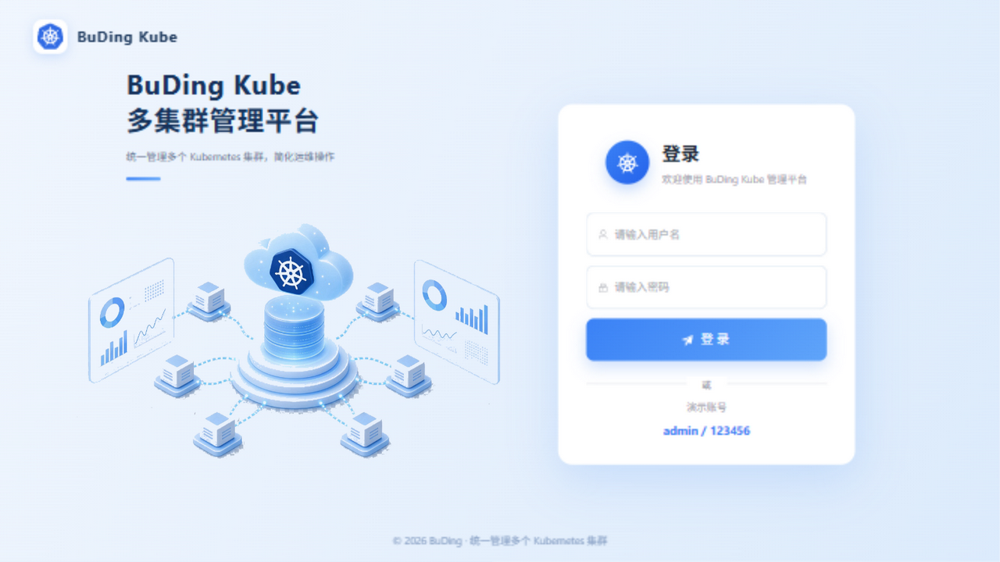 | 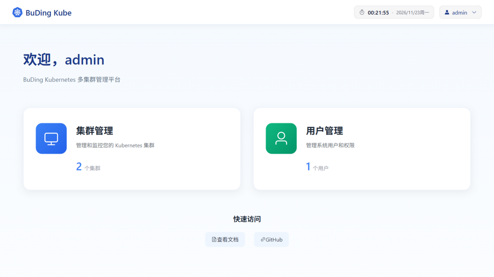 |
| _登录页_ | _平台首页_ |
| 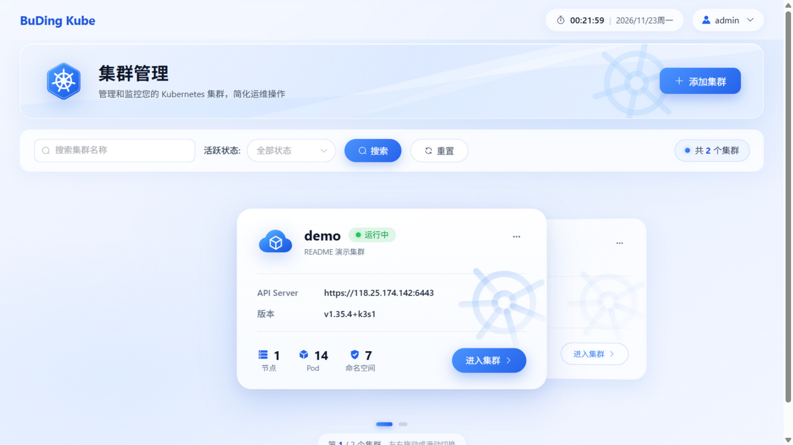 | 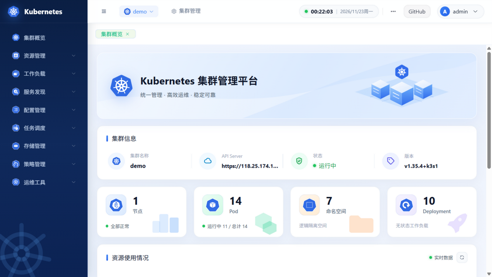 |
| _集群管理_ | _集群概览_ |
| 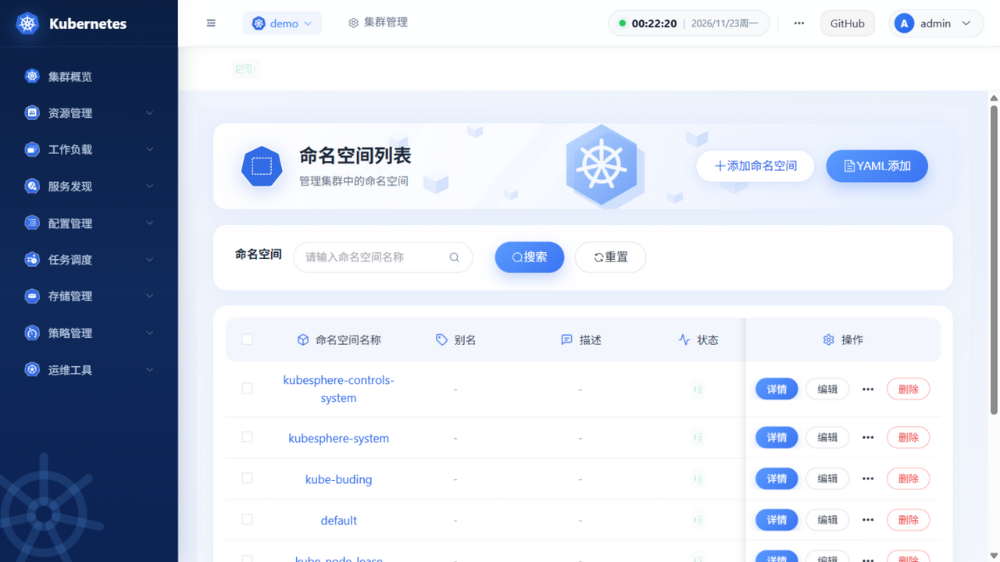 | 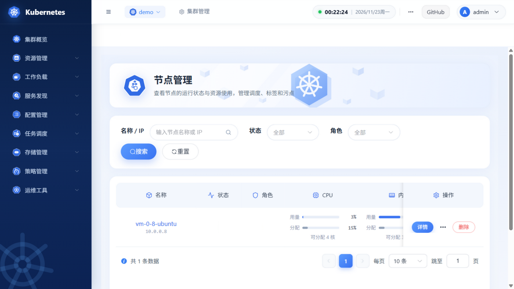 |
| _命名空间管理_ | _节点列表_ |
| 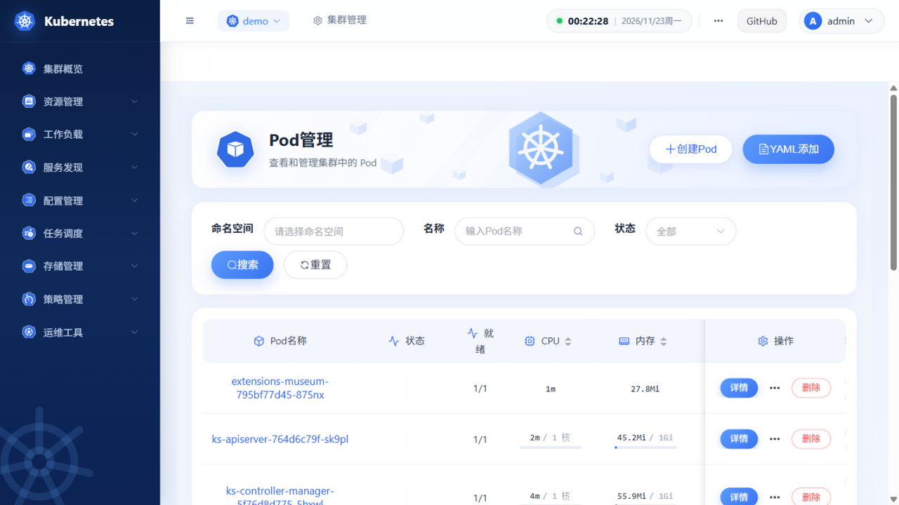 | 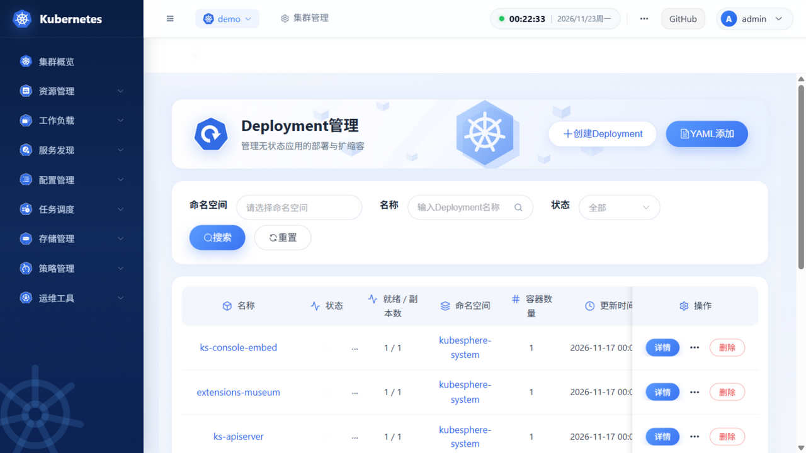 |
| _Pod 管理_ | _Deployment 管理_ |
| 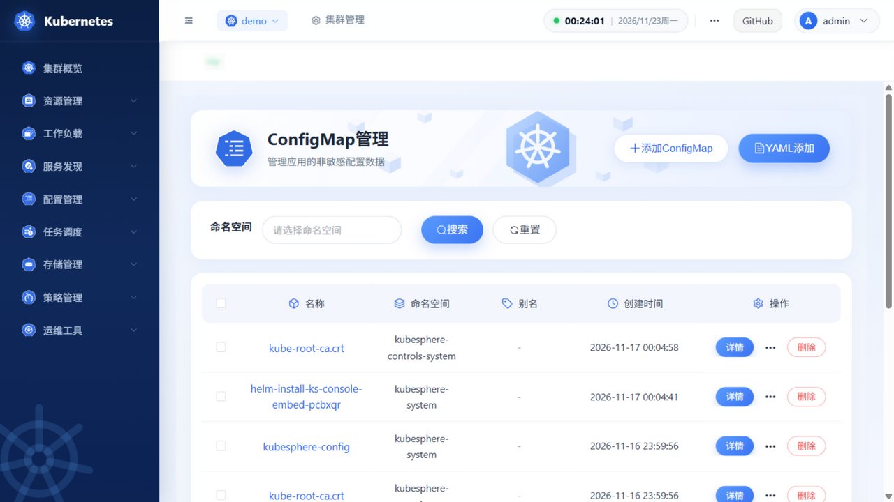 | 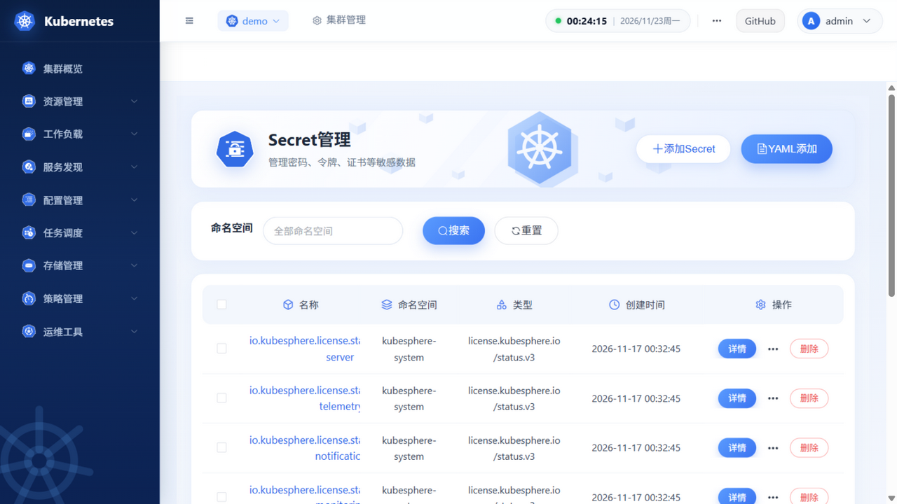 |
| _ConfigMap 管理_ | _Secret 管理_ |
| 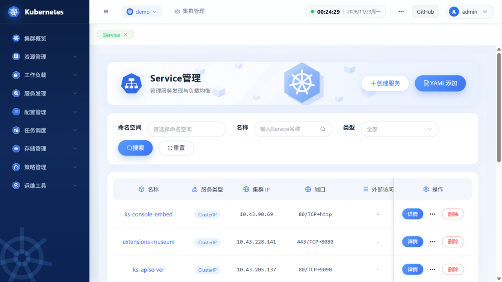 | 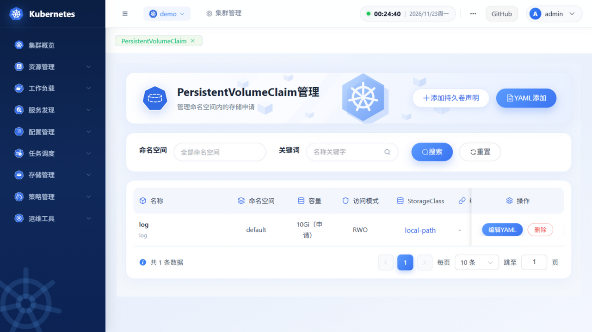 |
| _Service 管理_ | _持久卷声明（PVC）_ |
| 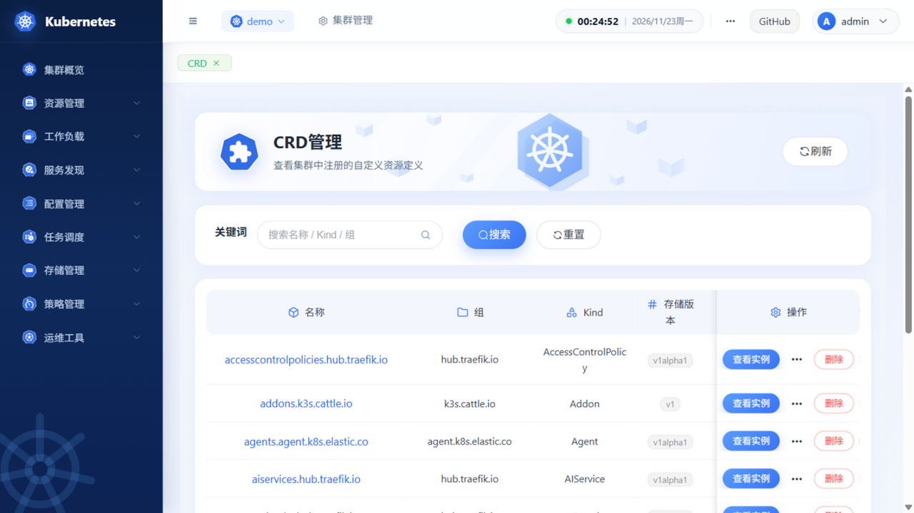 | 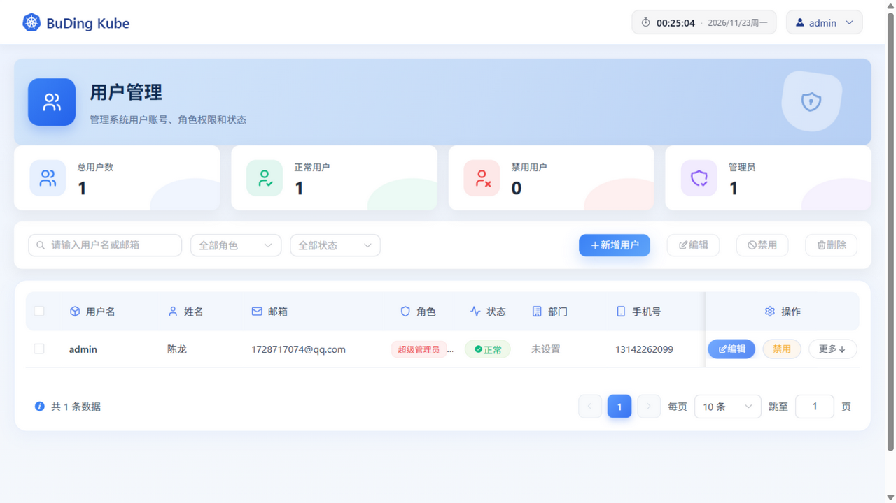 |
| _CRD 查询_ | _用户管理_ |

## ✅ 功能特性

### 集群
- 多集群接入、切换与管理，集群概览（资源用量、最近告警事件）
- 节点：资源分配与实时用量、标签 / 污点编辑、停止调度、排空节点（cordon + drain，遵守 PDB）
- 事件中心：按集群 / 命名空间 / 类型 / 资源查看全部事件
- Web kubectl：集群级 kubectl / helm 终端（仅管理员）

### 工作负载
- Deployment / StatefulSet / DaemonSet：分步创建、扩缩容、更新镜像、重新创建、版本回退
- 弹性伸缩（HPA）：按 CPU / 内存使用率自动调整副本数，工作负载详情中可直接设置
- ReplicaSet、Job / CronJob（重新执行、立即执行、暂停）
- Pod：详情、日志、容器终端、文件上传下载、CPU / 内存用量

### 服务与网络
- Service、Ingress（表单创建）、Endpoint / EndpointSlice、IngressClass
- 网络策略（NetworkPolicy）：表单 + 常用模板

### 配置、存储与策略
- ConfigMap / Secret / ServiceAccount
- PV / PVC 分步创建，StorageClass（存储系统模板）
- 资源配额（ResourceQuota）、默认资源限制（LimitRange），命名空间详情中可直接设置
- 中断预算（PDB）、优先级（PriorityClass）
- CRD 及其实例（例如 cert-manager 的 Certificate）的查看与 YAML 编辑

### 通用
- 所有资源支持查看 / 编辑 YAML、YAML 创建
- 标签式导航（一个菜单一个标签页）与页面状态保留
- 用户管理：账号 / 角色（超级管理员 / 管理员 / 普通用户）/ 启用禁用 / 重置密码，基于 JWT 认证
- 所有列表页统一操作规范：详情 → 更多（下拉操作）→ 删除（红色二次确认）

## 🏗️ 软件架构

buding-kube 采用前后端分离的架构设计：

- **后端**：基于 Golang 和 Gin 框架开发，使用 client-go 与 Kubernetes 集群交互，提供 Swagger 文档（`/api/swagger/index.html`）
- **前端**：Vue 3 + TypeScript + Vite + Element Plus + Pinia
- **数据存储**：集群凭证与用户数据以 CRD 形式存放在管理集群中，集群 kubeconfig 加密存储，无需额外的数据库
- **部署方式**：支持二进制、容器化与 Kubernetes 内部署

## 📦 快速开始

### 前置条件

- Kubernetes 集群 (v1.20+) 作为管理集群
- Go 1.25+（后端编译）
- Node.js 16+ / pnpm（前端构建）

### 默认账号

```
用户名: admin
密码:   123456
```

> 首次登录后请立即在「个人信息」中修改密码。

### 方式一：源码运行（开发体验）

```bash
# 1. 启动后端（默认端口 8080，可用 KUBE_RUNTIME_PORT 修改）
git clone https://github.com/chenlong1728717074/buding-kube.git
cd buding-kube
go mod tidy

# 设置密钥（生产环境必须更换）
export JWT_SECRET_KEY=your-jwt-secret        # 登录令牌签名 + 集群凭证加密
export KUBE_SECRET_KEY=your-kube-secret      # 可选，单独指定集群凭证加密密钥
go run main.go

# 2. 启动前端（另开一个终端）
cd front
pnpm install
pnpm dev
# 浏览器访问 http://localhost:5173
```

前端 API 地址由 `front/.env` 中的 `VITE_API_BASE_URL` 控制（默认 `http://127.0.0.1:8888/api`），按需修改；开发模式下也可以走 `vite.config.ts` 内置的 `/api` 代理。

### 方式二：生产部署（二进制 + Nginx）

```bash
# 1. 构建后端
CGO_ENABLED=0 go build -o kube main.go
# Linux 服务器上运行（放好 configs/ 目录与环境变量）
export JWT_SECRET_KEY=your-jwt-secret
export KUBE_SECRET_KEY=your-kube-secret
./kube

# 2. 构建前端
cd front
pnpm install
pnpm build       # 产物在 dist/

# 3. Nginx 托管前端并反代后端
```

```nginx
server {
    listen 80;
    root /var/www/buding-kube/dist;
    index index.html;

    location / {
        try_files $uri $uri/ /index.html;   # 前端 history 路由
    }

    location /api/ {
        proxy_pass http://127.0.0.1:8080;   # 后端地址（路径原样转发，含 /api 前缀）
        proxy_set_header Host $host;
        proxy_set_header X-Real-IP $remote_addr;
        # Web 终端 / 日志为长连接，需要支持 WebSocket
        proxy_http_version 1.1;
        proxy_set_header Upgrade $http_upgrade;
        proxy_set_header Connection "upgrade";
        proxy_read_timeout 3600s;
    }
}
```

### 方式三：容器部署

```bash
# 构建镜像（Dockerfile 需要先把后端编译为 kube 二进制放在仓库根目录）
CGO_ENABLED=0 go build -o kube main.go
docker build -t buding-kube:latest .
docker run -d -p 8080:8080 \
  -e JWT_SECRET_KEY=your-jwt-secret \
  -e KUBE_SECRET_KEY=your-kube-secret \
  buding-kube:latest
```

### 方式四：部署到 Kubernetes

```bash
kubectl apply -f devlop.yaml
# devlop.yaml 包含 Secret（密钥，请修改为真实值）、RBAC、Deployment 与 Service
```

### 环境变量

| 变量 | 说明 |
| --- | --- |
| `KUBE_RUNTIME_PORT` | 后端监听端口（默认 8080） |
| `JWT_SECRET_KEY` | 登录令牌签名密钥，生产环境必须修改 |
| `KUBE_SECRET_KEY` | 集群凭证加密密钥（未设置时回退使用 `JWT_SECRET_KEY`），**更换后已接入集群需要重新录入 kubeconfig** |
| `APP_ENV=demo` | 演示模式：禁止写操作和终端 |
| `KUBECTL_IMAGE` | Web kubectl 使用的镜像，默认 `alpine/k8s:1.35.10`，内网环境改为可访问的镜像 |

> Web kubectl 首次使用时会在目标集群创建命名空间 `buding-kubectl`、绑定 cluster-admin 的服务账户，并为每个用户运行一个容器组（24 小时后回收）；平台接入集群所用的凭证需要有这些权限。
> `configs/` 目录存放本地运行配置与 kubeconfig，已被 gitignore，请勿提交真实凭证。

## 🖥️ 使用说明

1. **接入集群**：登录后进入「集群管理」→「添加集群」，粘贴目标集群的 kubeconfig 内容保存；集群卡片上点击「进入集群」即可管理该集群
2. **资源管理**：左侧菜单按 资源管理 / 工作负载 / 服务发现 / 配置管理 / 任务调度 / 存储管理 / 策略管理 分类，所有列表页支持关键字搜索、筛选、分页
3. **查看 / 编辑**：每行操作为「详情 → 更多（下拉操作）→ 删除」；详情页提供结构化信息展示，YAML 查看与编辑在「更多」或独立入口中
4. **创建资源**：列表页右上角「+ 创建」走表单分步创建，「YAML 添加」直接粘贴 manifest
5. **用户与权限**：右上角头像下拉切换个人信息 / 用户管理（管理员可见）；角色分为 超级管理员 / 管理员 / 普通用户
6. **标签导航**：顶部标签栏记录访问过的页面，右键标签可刷新 / 批量关闭，切换标签不丢失页面状态

## 🔧 开发说明

```bash
# 后端开发
go mod tidy
go run main.go

# 前端开发
cd front
pnpm install
pnpm dev

# 类型检查 / 构建与预览
pnpm typecheck
pnpm build
pnpm preview
```

## 🤝 参与贡献

1. Fork 本仓库
2. 新建功能分支 (`git checkout -b feature/amazing-feature`)
3. 提交更改 (`git commit -m 'Add some amazing feature'`)
4. 推送到分支 (`git push origin feature/amazing-feature`)
5. 提交 Pull Request

## 📄 许可证

本项目采用 MIT 许可证 - 详见 [LICENSE](LICENSE) 文件

## ⚠️ 项目状态

**注意：本项目目前处于积极开发阶段，API 和功能可能会有变动。**

欢迎有兴趣的开发者参与贡献，共同完善这个轻量级的 Kubernetes 多集群管理工具！
